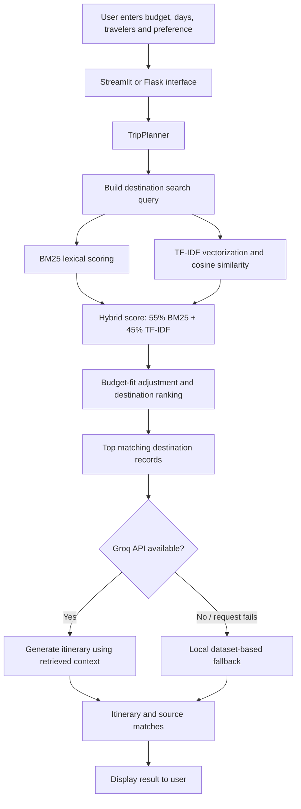

# TripWise AI — Smart Travel Planner

<p align="center">
  <strong>An AI-assisted travel planner that recommends destinations and creates itinerary outlines based on a group's budget, trip duration and interests.</strong>
</p>

<p align="center">
  <a href="https://tripwise-ai-main1.streamlit.app/">Live Demo</a> ·
  <a href="https://github.com/suryaprakash87436/TripWise-AI">Source Code</a>
</p>

---

## Table of Contents

- [Project Overview](#project-overview)
- [Problem Statement](#problem-statement)
- [Project Objectives](#project-objectives)
- [Key Features](#key-features)
- [Skills and Technologies](#skills-and-technologies)
- [System Architecture](#system-architecture)
- [How It Works](#how-it-works)
- [Project Structure](#project-structure)
- [Getting Started](#getting-started)
- [Configuration](#configuration)
- [Run the Applications](#run-the-applications)
- [Deployment](#deployment)
- [Limitations](#limitations)
- [Possible Future Enhancements](#possible-future-enhancements)
- [Resume-Ready Project Summary](#resume-ready-project-summary)

## Project Overview

**TripWise AI** is an AI-assisted travel planning application built with Python. It accepts a user's total group budget, trip duration, number of travelers and travel preference, then searches a curated destination dataset to recommend relevant places and prepare an itinerary outline.

The project combines a custom **BM25** lexical ranking implementation with **TF-IDF cosine similarity** for hybrid information retrieval. When a Groq API key is configured, retrieved destination records are supplied as context to a language model to generate a more detailed itinerary. If the API key is absent or the API request fails, the application uses a local fallback response based on the retrieved dataset.

The repository includes a Streamlit interface for the live application and a Flask web/API entry point.

## Problem Statement

Planning a trip involves comparing destinations against budget, duration, group size and personal interests. A generic itinerary may not reflect the user's constraints, while recommendations without a clear source can be difficult to verify.

TripWise AI addresses this by:
- Collecting key trip requirements from the user.
- Searching a curated destination knowledge base.
- Ranking destinations using lexical and semantic-text similarity signals.
- Using retrieved records as context for optional AI-generated itinerary content.
- Providing a local fallback when the external language-model service is unavailable.

## Project Objectives

1. Build an easy-to-use travel planning interface.
2. Retrieve destinations relevant to user preferences from a curated dataset.
3. Combine BM25 and TF-IDF scores to improve destination ranking.
4. Consider the user's budget when ordering retrieved destinations.
5. Generate itinerary suggestions grounded in retrieved destination information.
6. Provide a fallback response that does not depend on the external LLM API.
7. Expose a Flask web interface and basic JSON endpoints alongside the Streamlit app.

## Key Features

- **Preference-based discovery:** Search destinations using travel interests such as beaches, nature, history or family trips.
- **Group-aware inputs:** Collect total group budget, trip duration and number of travelers.
- **Hybrid retrieval:** Combine custom BM25 ranking with TF-IDF cosine similarity.
- **Budget-aware ranking:** Apply a budget-fit adjustment using estimates available in the destination records.
- **Grounded AI itinerary:** Optionally use the Groq API with retrieved destination records as the prompt context.
- **Local fallback:** Generate a basic itinerary from the dataset when Groq is not configured or unavailable.
- **Transparent matches:** Return matching destinations, states and retrieval relevance scores.
- **Two application entry points:** Streamlit user interface and Flask web/API application.

## Skills and Technologies

| Area | Technologies / Skills |
|---|---|
| Programming | Python |
| User interfaces | Streamlit, HTML, CSS |
| Backend / API | Flask, REST-style JSON endpoints |
| Generative AI | Groq API, LLM prompting, grounded generation |
| Information retrieval | BM25, TF-IDF, cosine similarity, hybrid ranking |
| Machine learning toolkit | scikit-learn |
| Data processing | Text parsing, tokenization, ranking and scoring |
| API integration | Requests, HTTP error handling, timeouts |
| Configuration | python-dotenv, environment variables |
| Deployment configuration | Streamlit Community Cloud, Render Blueprint |
| Version control | Git, GitHub |
| Testing | pytest |

## System Architecture



## How It Works

1. **Collect trip details:** The user enters a total group budget, number of days, number of travelers and a travel preference.
2. **Build a query:** The planner combines the preference, duration and budget into a search query.
3. **Tokenize:** Text is normalized into lowercase alphanumeric tokens for BM25 scoring.
4. **Calculate BM25 scores:** A custom BM25 Okapi index ranks destination records by term relevance.
5. **Calculate TF-IDF scores:** Scikit-learn creates TF-IDF vectors using unigrams and bigrams, then calculates cosine similarity against the query.
6. **Combine retrieval scores:** The implementation normalizes BM25 scores and combines them with TF-IDF similarity using a 55% BM25 and 45% TF-IDF weighting.
7. **Apply budget fit:** A budget-fit adjustment is applied using budget estimates present in the destination record. These estimates are approximate dataset values.
8. **Generate an itinerary:** If Groq is configured, the retrieved records are passed as context to the LLM. Otherwise, the local fallback creates a basic itinerary from the best match.
9. **Return matches:** The application returns the itinerary, generation mode and ranked destination matches with relevance scores.

## Project Structure

```text
TripWise-AI/
├── app.py                  # Flask application and JSON endpoints
├── streamlit_app.py        # Streamlit travel planner interface
├── planner.py              # Dataset parsing, BM25, TF-IDF and itinerary logic
├── data/
│   └── destinations.txt    # Curated destination knowledge base
├── templates/
│   └── index.html          # Flask web page
├── static/
│   └── style.css           # Flask interface styles
├── tests/
│   └── test_planner.py     # Planner parsing and retrieval tests
├── requirements.txt        # Python dependencies
├── render.yaml             # Render deployment configuration
├── .gitignore
└── README.md
```

## Getting Started

### Prerequisites

- Python 3.11 (the Render configuration specifies Python 3.11.9).
- Git.
- A Groq API key for LLM-generated itineraries (optional; local fallback is available without it).

### 1. Clone the repository

```bash
git clone https://github.com/suryaprakash87436/TripWise-AI.git
cd TripWise-AI
```

### 2. Create and activate a virtual environment

**Windows PowerShell**
```powershell
py -3.11 -m venv .venv
.\.venv\Scripts\Activate.ps1
```

**macOS / Linux**
```bash
python3.11 -m venv .venv
source .venv/bin/activate
```

### 3. Install dependencies

```bash
python -m pip install --upgrade pip
pip install -r requirements.txt
```

## Configuration

For Groq-powered itinerary generation, create a `.env` file in the project root:

```env
GROQ_API_KEY=your_groq_api_key
GROQ_MODEL=openai/gpt-oss-20b
```

The Streamlit app reads Streamlit Community Cloud secrets as well as local environment variables. On Streamlit Community Cloud, add:

```toml
GROQ_API_KEY = "your_groq_api_key"
GROQ_MODEL = "openai/gpt-oss-20b"
```

The local dataset-based fallback works without a Groq key. Never commit a real API key or place it in source code, README files or screenshots.

## Run the Applications

### Streamlit application (primary live demo)

```bash
streamlit run streamlit_app.py
```

Open the local URL shown in the terminal, usually `http://localhost:8501`.

### Flask application

```bash
python app.py
```

The Flask server uses the `PORT` environment variable when provided and otherwise defaults to port `5000`.

Available Flask routes:
- `GET /` — Flask web interface.
- `POST /plan` — Generate a trip plan; accepts form data or JSON.
- `GET /health` — Basic service health response.
- `GET /api` — Basic API information.

### Run the tests

```bash
python -m pytest -q
```

## Deployment

### Streamlit Community Cloud

The current public Streamlit application is available here:

**[Open TripWise AI](https://tripwise-ai-main1.streamlit.app/)**

For a separate deployment:
1. Sign in to [Streamlit Community Cloud](https://share.streamlit.io/) using GitHub.
2. Select this repository and the `main` branch.
3. Set the main file path to `streamlit_app.py`.
4. Add `GROQ_API_KEY` and `GROQ_MODEL` under app Secrets if LLM generation is required.
5. Deploy and verify the application.

### Render configuration

The repository includes a `render.yaml` Blueprint for the Flask application. It configures a web service using `gunicorn`, a health-check route at `/health`, and environment variables for the dataset and Groq model. To use this deployment path, create or sync the Blueprint in [Render](https://render.com/) and provide the secret `GROQ_API_KEY` in the service environment.

## Dataset

The application reads destination records from `data/destinations.txt`. The records contain fields such as destination, state, travel type, estimated budget, famous attractions and travel tips.

Recommendations are limited to the content of this bundled dataset. Updating the dataset changes the destination knowledge available to the planner.

## Limitations

- Destination coverage depends on the bundled dataset; it is not a live travel inventory.
- Budget information is based on stored estimates and is not a real-time quote.
- The application does not book hotels, transport or activities and does not process payments.
- It does not currently check live weather, transport schedules, opening hours or availability.
- Groq-generated responses depend on API availability and the quality of retrieved context.
- The local fallback is intentionally basic and should be treated as a planning outline, not a confirmed itinerary.

## Possible Future Enhancements

- Expand and maintain the destination dataset with verified sources and update dates.
- Add live weather, transport, hotel-price and availability integrations.
- Improve budget estimation by separating transport, accommodation, food and activity costs.
- Add map-based destination visualization and route planning.
- Add user accounts, saved itineraries and downloadable PDF exports.
- Add broader automated tests and a GitHub Actions CI workflow.
- Add multilingual itinerary generation and accessibility-focused recommendations.

## Resume-Ready Project Summary

**TripWise AI — AI-Assisted Travel Planner | Python, Streamlit, Flask, Groq API, BM25, TF-IDF, scikit-learn**

- Built a travel-planning application that collects budget, trip duration, group size and user preferences.
- Implemented hybrid destination retrieval by combining custom BM25 Okapi scoring with TF-IDF cosine similarity.
- Integrated the Groq API to generate itinerary suggestions grounded in retrieved destination records, with a local fallback mode.
- Developed Streamlit and Flask entry points and added pytest checks for dataset parsing and destination retrieval.

---

**Author:** Surya Prakash  
**Repository:** [suryaprakash87436/TripWise-AI](https://github.com/suryaprakash87436/TripWise-AI)
